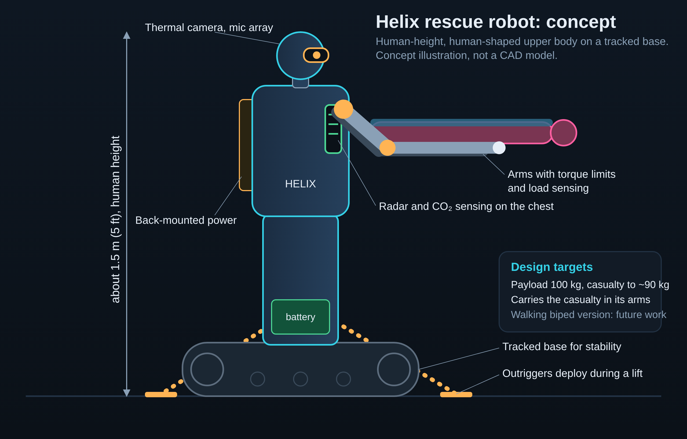

# Helix Command

**The decision layer for rescue robots.** Every detection verified, every risky move gated, every lift approved by a human commander.

A rescue unit in simulation finds, verifies and carries a casualty (up to about 90 kg alone) out of a **building fire**, a **flood** or a **collapse**. The planner proposes actions; a deterministic **safety gate** (plain code, no model) decides whether each action may run. Lifts, dispatches and public alerts wait for human approval.

> **Honest status.** This is a **simulation prototype**. It is not a certified rescue system, uses synthetic data only, and all physics and energy numbers are placeholders. The electrical-safety limits are placeholders for experts to set. Nothing here shows that a real robot can do this.

Simplifications: the fire scenario is a single floor plan with six rooms and two exits (the planning documents mention three floors); sensors, heat, smoke and current are toy models; the unit has global knowledge of temperature (as from a building fire-alarm system).

## Robot vision


The long-term vision the decision layer is built for: a human-shaped, human-height (about 5 ft) rescue robot with arms and legs that walks at human pace and carries a casualty of up to about 90 kg in its arms, with sensors in the head and chest. It is a concept illustration, not a CAD model, and not something built or tested yet. What exists today is the decision layer, proven in simulation.

## Robot designed as code
`robot/helix.urdf` describes the rescue robot in URDF, the format ROS and Gazebo read: 20 links, 19 joints (12 actuated), human height (about 1.5 m, 5 ft), about 80 kg (assumed), sensors in the head and chest, a back-mounted battery. Open `/web/robot.html` for a 3D viewer with joint sliders, a carry pose and a walking preview. The preview is a kinematic joint-angle animation for design review; it does not model balance, contact or real walking speed. `src/urdf.js` loads the file and computes forward kinematics, height, mass and centre of mass (7 tests).

## Run it

```bash
node local-server.js      # http://localhost:8080  (no dependencies, Node 20+)
npm test                  # 30 tests: gate rules, determinism, audit chain, injection, invariants, URDF model
npm run eval              # 100 randomised runs per scenario -> eval/RESULTS.md and eval/results.json
docker compose up         # same server in a container
```

Optional environment variables: `TELEGRAM_BOT_TOKEN` + `TELEGRAM_CHAT_ID` send a real Telegram message when the commander approves the dispatch (otherwise it is logged and the UI says so). `LLM_BASE_URL`, `LLM_API_KEY`, `LLM_MODEL` enable an advisory briefing endpoint (`/api/brief`) that is text only and never reaches the gate.

## What it does

| Scenario | Depth | Story |
| --- | --- | --- |
| Fire | Full | Fire spreads and blocks routes; the unit searches, verifies a casualty, gets approvals, covers them, carries them out and re-plans when an exit is lost |
| Water | Full | The unit has patrolled 2 hours (battery about 12%); it harvests from flowing water at a safe spot, then tows the casualty (flotation, head above water) to shore before they drift to a weir |
| Collapse | Working | Rubble grid; the unit listens, clears blocks within its lifting limit under a stability gate, and flags heavy blocks for a crane |

### Well and borewell rescue (`/web/well.html`, `src/well.js`)
A walking humanoid cannot go down a vertical shaft, so for wells the unit stays at the rim and works a **tethered winch**, lowering a rescue sling to the casualty. It verifies the casualty with two sensor types, measures depth and air (methane and oxygen), **ventilates before the winch runs if the air is foul** (the winch motor is assumed not explosion-proof), waits for commander approval (and a medic for a suspected spinal injury), anchors the frame, lowers at 0.5 m/s, secures the casualty, hoists slowly at 0.25 m/s, then carries them on foot to the safe zone. The gate refuses shafts deeper than the 30 m rope rating, loads over the 150 kg winch rating, hoists faster than 0.3 m/s and any winch movement before anchoring. With the gate off, the same run breaks gas and speed rules (shown on the page). Tests: `test/well.test.js`. **Children and unconscious casualties cannot hold a rope**, so for them the unit sends a small **tethered rescue pod** down the shaft on a dual-rope line (the humanoid stays at the rim). The pod floats on a collar with its camera above the water, cradles the casualty with soft arms and is hoisted up with them; the unit lifts the casualty out and walks them to the safe zone. The gate refuses this when the shaft is narrower than 70 cm (a borewell: the pod is about 50 cm across), when the casualty is more than 2.5 m under the surface (divers needed) or when pod plus casualty exceed the 200 kg descent rating. The winch, sling, rescue pod and its grip are **design assumptions, not built hardware**, and the evaluation table does not include this scenario.

### Multi-casualty rescue (People: 1 to 4)
With People set to 2 to 4, the unit does not stop after one rescue. It delivers a casualty to a safe zone, goes back out, and keeps going until the area is clear. When several casualties are known it does **triage**: the one with the least time left before the hazard wins goes first. A casualty it cannot move safely (over 90 kg, too close to the fire front, battery that cannot be recovered in time) is referred to the human team and the unit continues with the others. The unit never knows how many people there are: it finishes with a confirmation sweep and reports how many were delivered, referred or lost. Each lift and each handoff alert still needs human approval, and the evaluation numbers below are for the single-casualty runs (People = 1). Over seeds 1 to 30 with 3 casualties the gate kept safety violations at 0 in all three scenarios (`test/multi.test.js` checks 12 seeds each), but not every casualty can be saved: the unit refuses unsafe lifts by design.

### The agents
- **Mission:** plans (A* over a hazard-aware cost map), re-plans, decides when to harvest, refuse or escalate.
- **Operator:** executes moves and lifts in the simulation, only through the gate.
- **Verification:** a casualty counts only when two different sensor types agree (thermal, sound, CO2, radar, capacitive). Decoys and noise are rejected. Text from reports is **data, never instructions**.
- **Dispatch:** approvals inbox (commander, medic), human-team escalation, alert and incident report.

### The safety gate (`src/gate.js`)
Allow-list of actions; solo lift refused above 90 kg (checked on the estimate **and** again on the load sensor after the lift); temperature, depth, current and structural-risk limits; spinal injury needs medic approval; casualty must be covered before being carried; flotation before towing; harvesting only with sealed generators, never with a casualty aboard or near, never in still water, with a ground-fault style cutoff; approvals have a timer and an unresponsive commander makes the unit hold and escalate, never act alone.

### Heat, water and swimming (design assumptions)
The dashboard shows a live **Robot ratings** card. Assumed limits: 150 °C when empty-handed, 70 °C while carrying (the casualty must stay below 70 °C); in water it wades up to 1 m, swims deeper with a buoyancy and propulsion module, and refuses water deeper than 2.5 m or flowing faster than 2 m/s. These are placeholders to be replaced by tested values; the unit is drawn as a humanoid (head, shoulders, arms) that visibly swims and carries the casualty.

### Energy
Harvest is a **range extender**, not a power source. Water harvest works only in moving water (a robot cannot gain energy from its own motion). Heat harvest is weak and rarely usable in the fire scenario: the evaluation shows that. All rates are assumptions in `src/scenarios.js`.

**Charging while moving (water, option "Charge while moving"):** the unit trickle-charges from the current while it swims to a casualty and while it tows one, so it rarely has to stop just to charge. A sealed turbine is assumed: no electrical path into the water or the casualty. The gate allows it only with leakage under the limit, in flowing but not too strong or deep water, and never with electrode-type harvesting; a leakage fault cuts it off at once (tested). The rate is a placeholder assumption and real hardware needs electrical-safety testing before any human contact. The evaluation table above was produced without this option.

### Audit log
Every event and gate decision is written to a SHA-256 hash chain (`src/audit.js`). The UI has a "Tamper test" that edits a copy and shows the chain breaking.

## Results (simulation)
See `eval/RESULTS.md`. It reports delivered rates, escalations, refusals of over-capacity casualties, safety violations with the gate ON (0) and OFF (many), injection attempts blocked, and time to handoff, including the failures. The gate costs throughput by design: a naive robot with no gate delivers more casualties and breaks safety invariants while doing it.

## Layout
```
src/util.js        RNG, SHA-256, A*
src/scenarios.js   fire / water / collapse packs and parameters (placeholders)
src/gate.js        deterministic safety gate
src/sim.js         world, sensors, verification, mission agent, approvals, dispatch
src/audit.js       hash-chained audit log
src/urdf.js        URDF loader, forward kinematics, model statistics
src/hal.js         hardware abstraction: gated actuator bus, simulated port, hardware placeholder (docs/HARDWARE_READY.md)
robot/helix.urdf   the robot, described as code
web/               dashboard (canvas + panels)
local-server.js    static server + /api/alert + /api/brief
eval/run.js        reproducible evaluation
test/              node:test suite
data/casualty_profiles.json   100 synthetic profiles
```

## Provenance and disclosure
Written by the team with an AI coding assistant. Open-source dependencies: none at runtime (Node standard library). This project was built **before** the AgentX 24-hour window as a prototype; it must be submitted to any event only if that event's organizers confirm in writing that pre-built work is allowed, and this disclosure stays in the README. Commit timestamps are real and unmodified.
